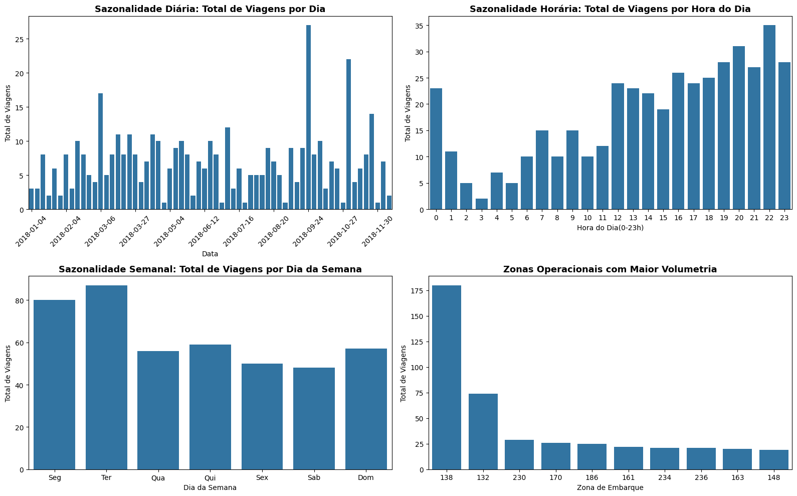
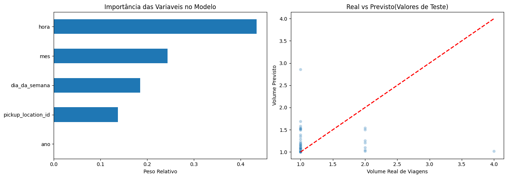

# 🚕 Previsão de Demanda de Táxis em Nova York (SQL + Python)

Case técnico de Data Science: preparar uma base de corridas de táxi de Nova York com **SQL (BigQuery)** e construir um **modelo preditivo** do volume de viagens por hora e por zona de embarque, com o objetivo de apoiar o dimensionamento de uma estação de integração de transporte.

> **Contexto:** o enunciado simula um pedido da equipe de Planejamento de Infraestrutura Urbana, que precisa entender a demanda histórica de táxis e prever o número de viagens por janela horária para decidir a expansão de baías, áreas de espera e alocação de frotas.

---

## 📌 Objetivos

1. **SQL:** filtrar corridas válidas, criar atributos temporais e agregar a demanda por data, hora e zona.
2. **EDA:** identificar sazonalidade diária, horária e semanal e as zonas com maior volume.
3. **Modelagem:** treinar um modelo para prever o total de viagens por hora e zona.
4. **Avaliação e conclusões:** medir o erro em conjunto de teste e traduzir os resultados em recomendações práticas.

## 🧰 Tecnologias

`Python` · `Pandas` · `NumPy` · `Matplotlib` · `Seaborn` · `Scikit-learn` · `Google BigQuery (Standard SQL)` · `Google Colab`

## 📁 Estrutura do repositório

```
.
├── notebooks/
│   └── analise_demanda_taxi_nyc.ipynb   # SQL via BigQuery + EDA + modelo + conclusões
├── sql/
│   ├── 01_preparacao_base_geral.sql     # Consulta consolidada (todas as zonas)
│   └── 02_base_modelagem_top10_zonas.sql# Consulta usada no notebook (10 zonas de maior volume)
├── images/                              # Gráficos exportados do notebook
├── requirements.txt
└── README.md
```

## 🗃️ Dados

Tabela de corridas de táxi de Nova York (formato TLC) hospedada em um projeto privado do BigQuery, com campos como `pickup_datetime`, `passenger_count`, `trip_distance`, `total_amount` e `pickup_location_id`.

> ⚠️ Os dados **não estão incluídos** neste repositório. O notebook consulta o BigQuery diretamente, então não é possível reproduzi-lo sem acesso ao projeto original (veja [Como executar](#-como-executar)).

## 🔧 Metodologia

### 1. Preparação dos dados (SQL)

Consulta em `WITH` (CTEs) com três etapas:

| Etapa | O que faz |
|---|---|
| `corridas_validas` | Mantém corridas com **1 a 4 passageiros**, **distância > 0** e **valor total > 0** |
| `corridas_com_features` | Extrai data, ano, mês, hora (0-23) e dia da semana de `pickup_datetime` |
| Agregação final | Agrupa por data, hora e `pickup_location_id`, retornando `total_viagens` e `faturamento_total` |

Na versão usada no notebook, a consulta foi restrita às **10 zonas de maior volume** (`138, 132, 230, 170, 186, 161, 236, 234, 163, 148`) para reduzir a esparsidade dos dados.

### 2. Análise exploratória

Gráficos de demanda por **hora do dia**, **dia da semana**, **evolução diária** e **ranking de zonas de embarque**.



### 3. Modelo preditivo

- **Algoritmo:** `RandomForestRegressor` (100 árvores, `max_depth=15`), escolhido por capturar relações não lineares sem exigir escalonamento.
- **Features:** `ano`, `mes`, `dia_da_semana`, `hora`, `pickup_location_id`
- **Target:** `total_viagens`
- **Divisão:** 80% treino / 20% teste (`random_state=42`)
- **Métricas:** MAE, RMSE e R²



## 📊 Resultados

| Métrica | Valor |
|---|---|
| R² | **-0,32** |
| MAE | 0,22 viagem |
| RMSE | 0,50 viagem |

**Importância das variáveis:** `hora` é a mais relevante (~43%), seguida de `mes`, `dia_da_semana` e `pickup_location_id`. `ano` praticamente não contribui.

### Interpretação honesta

O R² negativo indica que o modelo **não supera a média simples** como previsor. O gráfico "real vs previsto" mostra o motivo: a base agregada por data, hora e zona é muito **esparsa**, com contagens quase sempre entre 1 e 4 viagens por janela. Com tão pouca variação no alvo, o MAE baixo é enganoso, pois reflete o tamanho pequeno dos valores e não capacidade preditiva.

O resultado mais robusto do estudo é, portanto, **exploratório**: a **hora do dia** é o principal determinante da demanda.

## 💡 Recomendações para o planejamento

- Dimensionar baías de embarque pelo **pico horário**, e não pela média diária.
- Prever áreas de espera/amortecimento nas vias adjacentes para absorver picos.
- Ajustar a sinalização semafórica do entorno às curvas de demanda por hora.
- Tratar zonas de alto e baixo volume com soluções operacionais distintas.

> Estas recomendações são qualitativas. Com a qualidade atual do modelo, **não devem ser usadas para dimensionamento quantitativo** sem uma base maior e um modelo validado.

## ⚠️ Limitações e próximos passos

- **Divisão aleatória em série temporal:** `shuffle=True` mistura passado e futuro e pode inflar o desempenho. O ideal é um split cronológico ou validação com `TimeSeriesSplit`.
- **Pouca história e alta esparsidade:** é necessário um volume maior de dados ou agregação menos granular (por exemplo, por faixa de horário ou por grupo de zonas).
- **Sem baseline:** comparar com modelos ingênuos (média por hora/zona, sazonal ingênuo) para saber se o modelo agrega valor.
- **Features adicionais:** feriados, clima, eventos, lags e médias móveis.
- **Outros modelos:** regressão de contagem (Poisson/Negative Binomial), Gradient Boosting, Prophet/SARIMA.
- **Tratamento de janelas sem corrida:** zonas e horas sem viagens não aparecem na agregação; gerar o calendário completo com zeros tornaria o alvo mais fiel.

## ▶️ Como executar

```bash
git clone https://github.com/<seu-usuario>/<nome-do-repo>.git
cd <nome-do-repo>
python -m venv .venv && source .venv/bin/activate
pip install -r requirements.txt
jupyter notebook notebooks/analise_demanda_taxi_nyc.ipynb
```

O notebook foi desenvolvido no **Google Colab** e usa `google.colab.auth` para acessar o BigQuery. Para rodar com seus próprios dados, ajuste `PROJECT_ID` e o nome da tabela nas consultas de `sql/`.

## 👤 Autor

**Matheus Dias**
[LinkedIn](https://linkedin.com/in/matheus-dias-2b32432b2) · [GitHub](https://github.com/matheussdias84-tech)
